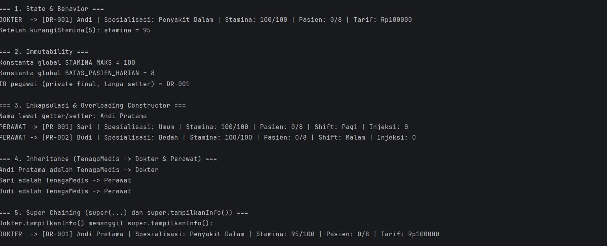
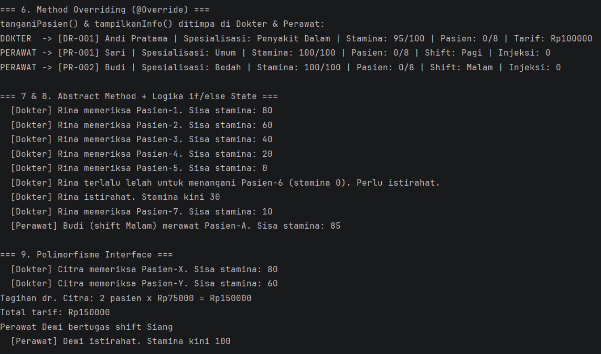
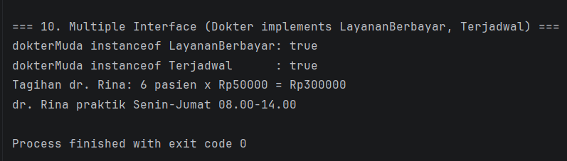

# Sistem Manajemen Tenaga Medis Rumah Sakit

Responsi Akhir Praktikum Pemrograman Berorientasi Objek
Jurusan Informatika, Fakultas Teknik, Universitas Jenderal Soedirman

## 1. Identitas

| Keterangan | Isi |
|---|---|
| Nama | Muhammad Farrel Rasyandi |
| NIM | H1D025137 |
| Digit terakhir NIM | 7 |
| Tema | **Rumah Sakit** |

## 2. Deskripsi Singkat

Sistem mensimulasikan tenaga medis rumah sakit (dokter dan perawat) yang menangani pasien.
Setiap tenaga medis punya stamina dan batas pasien harian; keputusan menerima atau menolak pasien
bergantung pada kondisi (state) tersebut.

| File | Peran |
|---|---|
| `LayananBerbayar.java` | Interface: tarif dan tagihan |
| `Terjadwal.java` | Interface: jadwal dan istirahat |
| `TenagaMedis.java` | Abstract superclass |
| `Dokter.java` | Subclass, implements `LayananBerbayar` dan `Terjadwal` |
| `Perawat.java` | Subclass, implements `Terjadwal` |
| `Main.java` | Pengujian 10 persyaratan |

## 3. Pemetaan Persyaratan Teknis

| No | Konsep | Lokasi dalam kode |
|---|---|---|
| 1 | State & Behavior | `TenagaMedis`: atribut `stamina`, `jumlahPasien`; void `kurangiStamina()`; fungsi `hitungSisaKapasitas()` |
| 2 | Immutability | `STAMINA_MAKS`, `BATAS_PASIEN_HARIAN` (`public static final`); `idPegawai` (`private final`) |
| 3 | Enkapsulasi & Overloading | Semua atribut `private` + getter/setter, `this`, dua constructor di setiap class |
| 4 | Inheritance | `Dokter` dan `Perawat` `extends TenagaMedis`; `Main` terpisah |
| 5 | Super Chaining | `super(...)` di constructor subclass; `super.tampilkanInfo()` |
| 6 | Overriding | `@Override` pada `tanganiPasien()` dan `tampilkanInfo()` |
| 7 | Abstract Class | `TenagaMedis` abstract dengan `abstract boolean tanganiPasien(String)` |
| 8 | Logika State | `if/else` di `tanganiPasien()` membaca stamina dan kapasitas, lalu mengubahnya |
| 9 | Polimorfisme Interface | `LayananBerbayar layanan = new Dokter(...)`, `Terjadwal jadwal = new Perawat(...)` |
| 10 | Multiple Interface | `Dokter implements LayananBerbayar, Terjadwal` |

## 4. Cara Compile dan Run (Terminal)

Prasyarat: JDK 11 atau lebih baru.

```bash
git clone <URL-REPOSITORI-ANDA>
cd RumahSakitPBO

# Compile
javac -d out src/*.java

# Run
java -cp out Main
```

## 5. Screenshot Luaran Program

> Jalankan program, ambil screenshot terminal, simpan di folder `screenshots/`, lalu ganti baris di bawah.

Persyaratan 1-5:



Persyaratan 6-9:



Persyaratan 10:


